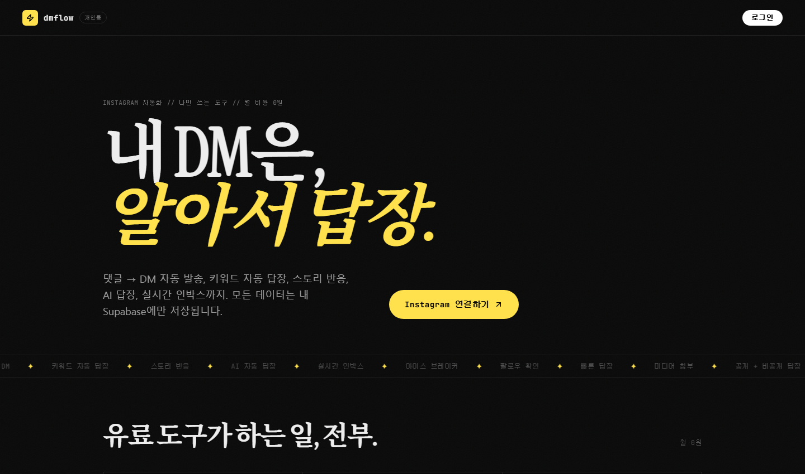

# ⚡ dmflow

**내 인스타그램 계정의 DM·댓글·스토리에 자동으로 답장해 주는 나만의 도구.**
ManyChat 같은 유료 서비스 대신, **내 Vercel + 내 Supabase**에서 무료로 돌리는 셀프호스팅 인스타 자동화입니다.

[](https://vercel.com/new/clone?repository-url=https%3A%2F%2Fgithub.com%2Fpblsketch%2Fdmflow-instaauto&project-name=dmflow&repository-name=dmflow&env=NEXT_PUBLIC_SUPABASE_URL,NEXT_PUBLIC_SUPABASE_ANON_KEY,SUPABASE_SERVICE_ROLE_KEY,NEXT_PUBLIC_INSTAGRAM_APP_ID,INSTAGRAM_APP_ID,INSTAGRAM_APP_SECRET,NEXT_PUBLIC_INSTAGRAM_REDIRECT_URI,INSTAGRAM_WEBHOOK_VERIFY_TOKEN,DASH_USER,DASH_PASS&envLink=https%3A%2F%2Fgithub.com%2Fpblsketch%2Fdmflow-instaauto%2Fblob%2Fmain%2Fdocs%2Fsetup-guide.md)

> 💡 **코딩을 몰라도 됩니다.** [📖 설치 가이드 (docs/setup-guide.md)](docs/setup-guide.md) 를 순서대로 따라 하면 약 30분 안에 완성됩니다.
> 인스타그램 프로페셔널(비즈니스/크리에이터) 계정과 무료 Supabase·Vercel·Meta 개발자 계정만 있으면 됩니다.

<p align="center">
  
</p>

---

## ✨ 이런 걸 할 수 있어요

| 기능 | 설명 |
|---|---|
| 💬 **DM 키워드 자동 답장** | "가격"이라고 DM을 보내면 내가 정한 답장이 자동 발송 |
| 📮 **댓글 → DM 자동 발송** | 게시물·릴스 댓글에 "자료"를 달면 공개 답글 + DM으로 링크/자료 전송 |
| 🔒 **팔로우 게이트** | 팔로우한 사람에게만 자료 전달. "팔로우 했어요" 버튼 후 자동 확인 |
| 📖 **스토리 트리거** | 스토리 멘션·답장·이모지 반응에 자동 반응 |
| 🤖 **AI 자동 답장** | 키워드에 안 걸리는 DM은 AI가 내 사업 정보를 바탕으로 사람처럼 답장 (Groq/OpenAI 호환) |
| 🧊 **아이스 브레이커** | 인스타 프로필의 대화 시작 버튼 (최대 4개) 관리·동기화 |
| 📥 **실시간 인박스** | 모든 대화를 한 화면에서 보고, 직접 답장까지 |
| 📊 **인사이트** | 자동화 수·발송 수·도달 수 통계 |

## 🧭 어떻게 동작하나요?

```txt
누군가 내 인스타로 DM / 댓글 / 스토리 답장을 보냄
        ↓ (Instagram이 웹훅으로 알려줌)
내 앱 (Vercel 서버) 이 등록된 규칙과 대조
        ↓
내 Supabase에 기록 + Instagram API로 자동 답장 발송
```

- 모든 데이터(대화·토큰·규칙)는 **오직 내 Supabase 프로젝트에만** 저장됩니다.
- 서버는 **내 Vercel**에서 24시간 돌아갑니다 (내 컴퓨터를 켜둘 필요 없음).
- Instagram의 **공식 API**(Instagram API with Instagram Login)만 사용합니다 — 스크래핑/매크로 아님.

## 🚀 시작하기

### 방법 1 — 버튼으로 배포 (가장 쉬움, 추천)

위의 **[Deploy with Vercel]** 버튼 → GitHub 로그인 → 저장소 이름 확인 → 환경변수 입력 → Deploy.

준비 순서와 각 환경변수 값을 어디서 가져오는지는 아래 가이드에 그림처럼 정리해 두었습니다:

> 📖 **[설치 가이드(docs/setup-guide.md)](docs/setup-guide.md)** — 이 문서만 따라 하세요!

### 방법 2 — GitHub에서 Fork 후 Vercel에서 가져오기

1. 이 저장소 우측 상단 **[Fork]** 클릭 → 내 계정에 복사본 생성
2. [vercel.com/new](https://vercel.com/new) → 방금 만든 fork 선택 → 환경변수 입력 → Deploy

### 방법 3 — 로컬에서 실행 (개발자용)

```bash
git clone https://github.com/pblsketch/dmflow-instaauto.git
cd dmflow-instaauto
npm install
cp .env.example .env.local   # 값을 채우세요
npm run dev                  # http://localhost:3000
```

> 로컬에서는 `NEXT_PUBLIC_INSTAGRAM_REDIRECT_URI=http://localhost:3000/api/instagram/callback` 로 설정하고, Meta 앱의 redirect URI 목록에도 같은 주소를 추가하세요.

## 🔐 환경 변수 요약

| 변수 | 필수 | 설명 |
|---|---|---|
| `DASH_USER` / `DASH_PASS` | ✅ | 대시보드 접속 아이디/비밀번호 (**내가 직접 정함**). 미설정 시 사이트가 503으로 열리지 않습니다 |
| `NEXT_PUBLIC_SUPABASE_URL` | ✅ | Supabase 프로젝트 URL |
| `NEXT_PUBLIC_SUPABASE_ANON_KEY` | ✅ | Supabase 공개 키 |
| `SUPABASE_SERVICE_ROLE_KEY` | ✅ | Supabase 서버 전용 키 (⚠️ 절대 공개 금지) |
| `NEXT_PUBLIC_INSTAGRAM_APP_ID` / `INSTAGRAM_APP_ID` | ✅ | Meta의 **Instagram 앱 ID** — Meta 앱 ID가 아님! |
| `INSTAGRAM_APP_SECRET` | ✅ | Instagram 앱 시크릿 |
| `NEXT_PUBLIC_INSTAGRAM_REDIRECT_URI` | ✅ | OAuth 리다이렉트 주소 (`https://내주소/api/instagram/callback`) |
| `INSTAGRAM_WEBHOOK_VERIFY_TOKEN` | ✅ | 웹훅 검증 토큰 (아무 긴 랜덤 문자열, Meta에 같은 값 입력) |
| `META_APP_SECRET` | 선택 | 웹훅 서명 검증 401 오류가 날 때만 (Settings → Basic의 앱 시크릿) |
| `GROQ_API_KEY` | 선택 | AI 자동 답장 사용 시 |
| `AGENT_API_KEY` | 선택 | Muse·MCP 같은 AI 에이전트 연동 시 |
| `PRIVACY_CONTACT_EMAIL` | 선택 | /privacy 페이지에 표시할 문의 이메일 |

자세한 설명: [`.env.example`](.env.example) · [설치 가이드](docs/setup-guide.md#3단계-vercel에-배포하기-10분)

## ⚡ 첫 자동화 만들기 (1분)

1. 배포된 주소 접속 → `DASH_USER`/`DASH_PASS` 로그인
2. **Instagram 연결하기** 클릭 → 인스타 로그인 → 권한 허용
3. 왼쪽 메뉴 **자동 답장** →
   - **반응 대상**: `DM(다이렉트 메시지)`
   - **이런 말을 하면**: `가격`
   - **이 답장 보내기**: `안녕하세요! 가격 안내는 프로필 링크를 확인해 주세요 😊`
   - **[답장 저장]**
4. 다른 계정으로 내 인스타에 `가격` 이라고 DM → 자동 답장 도착 ✅

**댓글 → DM** 은: 반응 대상 `게시물 댓글` → 대상 게시물 선택 → 감지 키워드 `자료` → "DM으로 보낼 내용" 입력 → (원하면) ☑ `팔로우 확인 후 보내기` → **[답장 저장]**.

전체 예시와 팁은 [설치 가이드 6단계](docs/setup-guide.md#6단계-첫-자동화-만들기-5분)에서.

## ❓ 자주 묻는 질문

- **정말 무료인가요?** — 네. Supabase·Vercel 무료 요금제로 개인 계정 1개 운영은 충분합니다. 카드 등록 없이 시작 가능.
- **컴퓨터를 계속 켜둬야 하나요?** — 아니요. Vercel 서버에서 24시간 동작합니다.
- **내 데이터는 어디에 있나요?** — 오직 내 Supabase 프로젝트에만 저장되며, 운영자 본인만 볼 수 있습니다.
- **여러 인스타 계정을 관리할 수 있나요?** — 이 앱은 1인 1계정 설계입니다. 계정마다 각각 배포하세요.
- **배포했는데 503 "Auth not configured"가 떠요** — `DASH_USER`/`DASH_PASS` 미설정이 원인입니다. Vercel → Settings → Environment Variables에 추가 후 Redeploy.
- **웹훅 검증이 실패해요** — `INSTAGRAM_WEBHOOK_VERIFY_TOKEN`이 Meta에 입력한 값과 같은지, 배포 주소가 맞는지 확인. [문제 해결 표](docs/setup-guide.md#문제-해결) 참고.
- **봇으로 정지되지 않나요?** — 공식 API + 사용자 행동(메시지/댓글)에만 반응하는 방식이라 정책에 부합합니다. 단, 스팸성 사용은 인스타 정책 위반입니다.

## 🔄 업데이트 방법

- 이 저장소를 **Fork**했다면: GitHub에서 **Sync fork** 버튼 → Vercel이 자동 재배포
- **Deploy 버튼**으로 만든 내 저장소라면: GitHub에서 최신 변경사항 반영(또는 `git pull`) → Vercel 자동 재배포

## 🙏 크레딧 & 라이선스

이 프로젝트는 **[insta-p8](https://github.com/ayuuxh2/insta-p8)** ([@ayuuxh2](https://github.com/ayuuxh2), MIT License, © flexhunt) 을 기반으로 한국어 환경에 맞게 다듬은 버전입니다. 원본의 훌륭한 구조와 기능에 감사드립니다. 🙇

- 라이선스: **MIT** ([LICENSE](LICENSE)) — 자유롭게 사용·수정·배포하세요.
- 사용 시 Instagram 플랫폼 정책과 스팸 금지 규칙을 지켜주세요.

<details>
<summary><b>English summary</b></summary>

**dmflow** is a self-hosted, Korean-localized Instagram automation app — DM auto-replies, comment-to-DM funnels, story triggers, AI replies (Groq/OpenAI-compatible), ice breakers, and a live inbox.

Built with Next.js 16 + Supabase + Vercel. Based on [insta-p8](https://github.com/ayuuxh2/insta-p8) (MIT, © flexhunt). You will need your own Instagram professional account, Meta developer app, Supabase project, and Vercel account.

Deploy with the Vercel button above, or see the full walkthrough in [docs/setup-guide.md](docs/setup-guide.md) (Korean). Key env vars: `DASH_USER`/`DASH_PASS`, `NEXT_PUBLIC_SUPABASE_URL`, `SUPABASE_SERVICE_ROLE_KEY`, `NEXT_PUBLIC_INSTAGRAM_APP_ID`, `INSTAGRAM_APP_SECRET`, `INSTAGRAM_WEBHOOK_VERIFY_TOKEN`.

</details>
